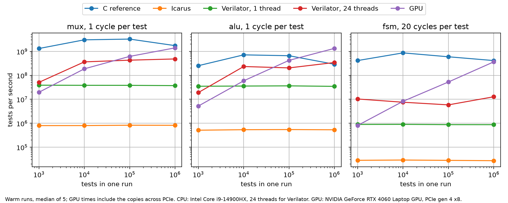

# bitlane

A gate-level logic simulator that runs on the GPU. Yosys flattens a Verilog design into
AND, OR, XOR, NOT and MUX gates plus D flip-flops, Python sorts the gates into levels,
and a CUDA kernel evaluates one level per launch for many tests at once. Each 32-bit
word holds the value of one net in 32 different tests, one test per bit, so a single
AND instruction simulates an AND gate 32 times. The NumPy, C and CUDA versions are
checked against Icarus Verilog, cycle by cycle, on random tests.

**The result.** On an 8-bit ALU (297 gates) the GPU simulates one million random tests
at 1.3 billion tests per second. That is 3.9 times Verilator on 24 worker threads in
the table below, but that column is noisy: across benchmark runs the ratio has been
2.6 to 3.9, and against the median of forty Verilator runs it is about 3. It is also
1.9 times a vectorised single-core C version of the same algorithm at its best batch
size (4.6 times at the same batch size). With 100,000 tests per run or fewer, or on
designs of one or two dozen gates, the CPU wins. The time runs from packed stimulus in
host memory to packed outputs in host memory, so the PCIe copies count and the packing
does not (see [Limits](#limits)).



Millions of tests per second at one million tests per run: warm runs (set up once, then
stimulus in host memory to outputs in host memory), wall clock, median of five. Intel
Core i9-14900HX with 24 Verilator worker threads; NVIDIA GeForce RTX 4060 Laptop GPU,
PCIe gen 4 x8. [What each column includes](docs/benchmark.md#what-each-column-includes).

| design | C reference | Icarus | Verilator, 1 thread | Verilator, 24 threads | GPU |
|---|---:|---:|---:|---:|---:|
| mux, 24 gates | 1,739 | 0.821 | 37.2 | 483 | 1,399 |
| alu, 297 gates | 290 | 0.533 | 34.7 | 343 | 1,334 |
| fsm, 14 gates, 20 cycles | 413 | 0.0274 | 0.871 | 12.7 | 364 |

The GPU wins on the ALU at one million tests and nowhere else in the full tables. At
100,000 tests and below a run is mostly fixed cost, launch overhead and PCIe copies, and
the mux and the state machine have too little work per test for the copies to pay off.
The single-core C version beats Verilator on 24 threads on both small designs: packing
32 tests into a word is what makes the algorithm fast, on either processor.

More detail:

- [docs/benchmark.md](docs/benchmark.md): the full tables at every size, the cold runs,
  when the GPU wins and when it doesn't, what each column includes, how to rerun it.
- [docs/profiling.md](docs/profiling.md): the Nsight Compute profile and the
  memory-layout change it tested.
- [docs/ml-kernels.md](docs/ml-kernels.md): what the work has in common with ML kernels.

## How it works

1. **Synthesis.** `scripts/synth.ys` has Yosys flatten the design into five gate types
   and one flip-flop type (positive edge, D input). Enables and synchronous resets
   become logic in front of D. The result is a JSON netlist.
2. **Levels.** Inputs, constants and flip-flop outputs are level 0. A gate's level is
   one more than the highest level among its inputs (Kahn's algorithm). Gates in the
   same level do not depend on each other, so they can all be evaluated at once.
   Gates left unsorted are on a combinational loop or fed by one, and are reported as
   an error.
3. **Packing.** The gates are stored as flat arrays sorted by level. Values live in
   `vals[row][word]`, each net in a row: bit `t` of word `w` is the net's value in test
   `32 * w + t`. A gate is then one bitwise operation per word; a MUX is
   `(b & s) | (a & ~s)`. A gate's output takes over the row of a net whose last reader
   is in an earlier level, the way a register allocator or an ML compiler's memory
   planner reuses buffers, so the ALU's 318 nets need 148 rows.
4. **The kernel** ([`cuda/kernel.cu`](cuda/kernel.cu)). One launch per level, one
   thread per (gate, word). Thread `i` of a launch takes the level's gate `i / n_words`
   and word `i % n_words`, so neighbouring threads read and write neighbouring words of
   the same rows and the memory accesses coalesce.
5. **The clock.** Each cycle applies the inputs, evaluates the levels in order, samples
   the outputs, then lets every flip-flop capture its D: read every D first, then
   write every Q.

## Quick start

Needs an NVIDIA GPU with the CUDA toolkit (`nvcc` on `PATH`), CMake 3.24 or newer,
gcc, g++ and make (`build-essential` on Ubuntu), Yosys, Icarus Verilog, Verilator and
[uv](https://docs.astral.sh/uv/). Developed on Ubuntu 24.04 under WSL2 with CUDA 13.3,
Yosys 0.33, Icarus Verilog 12.0 and Verilator 5.020. The shared library is built by
CMake the first time it is needed; `cuda/CMakeLists.txt` targets the RTX 4060's
architecture (`sm_89`), so change `CUDA_ARCHITECTURES` for another GPU.

```bash
uv run pytest                                         # the full test suite
uv run bitlane synth designs/alu.v                    # Verilog to gates: build/alu.json
uv run bitlane levels build/alu.json                  # gates per level, nets and rows
uv run bitlane check designs/alu.v --gpu              # "matches Icarus", or the mismatch
uv run bitlane check designs/fsm.v --reset rst --gpu  # a clocked design needs --reset
```

The benchmark and the profiler have their own commands in
[docs/benchmark.md](docs/benchmark.md#reproducing) and
[docs/profiling.md](docs/profiling.md#reproducing).

## Correctness

Icarus Verilog is the reference. A generated testbench replays the same random stimulus
through the original Verilog, and every output is compared in every cycle of every
test. bitlane is two-state (0 or 1) and its flip-flops start at 0 in every test; Icarus
is four-state, its flip-flops start at x, and it runs the tests back to back in one
simulation, so each test starts where the previous one ended. Every test of a clocked
design therefore begins with a reset cycle, the comparison starts in the cycle after
it, and an x or z from Icarus after reset counts as a mismatch.

`bitlane check` runs 10,000 random tests of 20 cycles each through the NumPy simulator,
or through the CUDA kernel with `--gpu`. The test suite compares the NumPy simulator,
the C version and the CUDA kernel with Icarus on five designs, the kernel with the C
version word for word, and the Verilator harness with the NumPy simulator. It also
covers edge cases in the netlist reader (x and z bits, outputs wired straight to an
input or a constant, two clocks), the level sorter (a combinational loop) and the Icarus
harness (port names that clash with the testbench, paths with spaces). The benchmark
itself only times the simulators; the GPU was checked separately against Icarus on each
benchmark's exact one-million-test stimulus, and matched on all three designs.

## Limits

- One clock, positive edge only, no memories, no latches. An asynchronous reset is
  rejected by the Yosys flow. The reset must be synchronous and active-high: `--reset`
  holds the named port at 1 in the first cycle only, and that cycle must leave every
  flip-flop at a known value.
- Two-state only: an x in the netlist becomes 0 with a warning, a z is an error.
  Ports are at most 64 bits wide. A design with no input other than the clock is not
  supported.
- The stimulus is uniform random. After the first cycle the reset port is random like
  every other input, so tests of a clocked design seldom get far from reset.
- The designs are tiny, 14 to 297 gates. Nothing here says how a large design behaves.
- The headline is packed-simulation throughput. Packing a million ALU tests in NumPy
  takes about 106 ms and unpacking the outputs 30 ms, against 0.75 ms for the run
  itself, so with packing and unpacking counted the current code does about 7 million
  tests per second.
- The C reference is single-threaded. The GPU at its best is 1.9 times one core at its
  best batch size, so a multi-threaded C version would very likely overtake it.
- One machine, one laptop GPU. The numbers move with temperature and background load.
  Verilator's 24-thread figure is the noisiest: the threads are not pinned, and the
  slowest one decides the time.

## Repository layout

| Path | What it holds |
|---|---|
| `scripts/synth.ys`, `src/bitlane/synth.py` | the Yosys flow |
| `src/bitlane/netlist.py` | the JSON reader: nets, gates, flip-flops, the clock |
| [`src/bitlane/levels.py`](src/bitlane/levels.py) | level sorting, row assignment and the packed arrays |
| [`src/bitlane/refsim.py`](src/bitlane/refsim.py) | the NumPy simulator, the readable version of the algorithm |
| [`cuda/refsim.c`](cuda/refsim.c), [`cuda/kernel.cu`](cuda/kernel.cu), `cuda/bitlane.h` | the C baseline, the CUDA kernel, their shared interface |
| `src/bitlane/native.py` | calls the C and CUDA code through ctypes |
| `src/bitlane/stimulus.py` | random stimulus, with the reset port held at 1 in the first cycle |
| `src/bitlane/icarus.py`, `src/bitlane/verilator.py` | the Icarus harness and compare; the Verilator harness |
| `src/bitlane/bench.py`, `scripts/chart.py`, `scripts/gpu_run.py` | the benchmark, the chart, one workload for the profiler |
| `src/bitlane/__init__.py` | the `bitlane` command: synth, levels, sim, check, bench |
| `designs/`, `tests/`, `results/`, `docs/` | the five designs, the tests, the benchmark results and chart, the write-ups |

## Future work

- Fewer launches: fuse small levels, or replay the launch sequence with CUDA Graphs.
- Pinned host memory, copies that overlap the kernels, and rows padded to a multiple
  of 8 words so that every load is sector-aligned.
- Stimulus generated packed, and outputs compared packed.
- A multi-threaded C reference, and a real design: PicoRV32, which needs memories.

## License

MIT; see [LICENSE](LICENSE).
